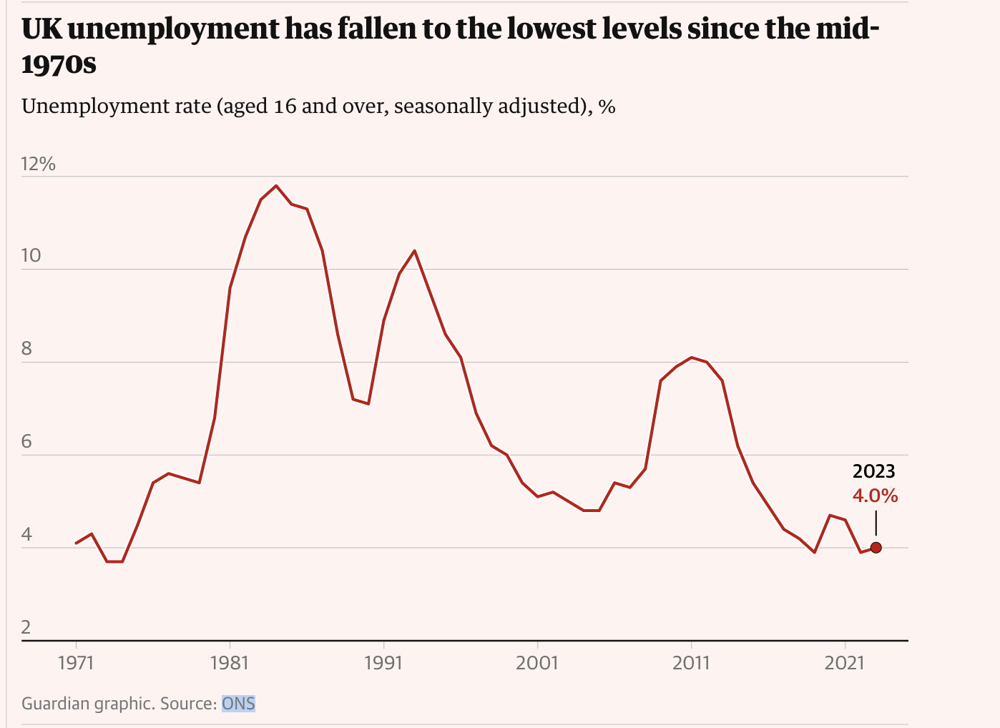
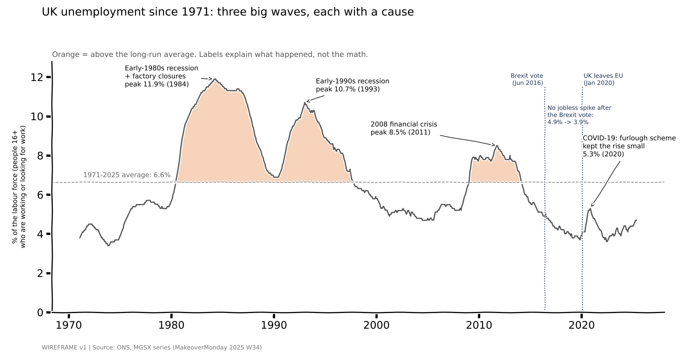
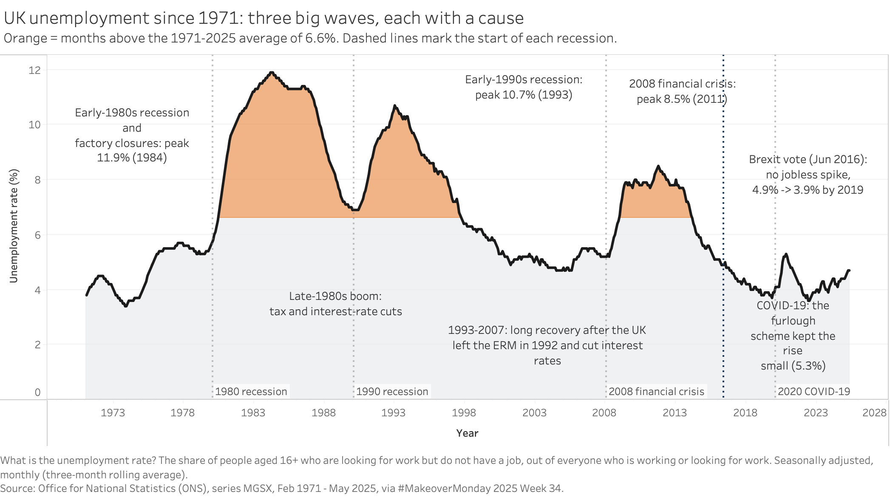

| [home page](https://chenanchien.github.io/kevin-chien-portfolio/) | [data viz examples](dataviz-examples.md) | [critique by design](critique-by-design.md) | [critique & redesign: UK unemployment](critique-redesign-uk-unemployment.md) | [final project I](final-project-part-one.md) | [final project II](final-project-part-two.md) | [final project III](final-project-part-three.md) |

# Critique and Redesign: UK Unemployment Since 1971

## Step 1: The original visualization

**Original:** [Unemployment rate (aged 16 and over, seasonally adjusted): %](https://www.ons.gov.uk/employmentandlabourmarket/peoplenotinwork/unemployment/timeseries/mgsx/lms), Office for National Statistics (ONS), series MGSX. Featured in [MakeoverMonday 2025 Week 34](https://makeovermonday.vercel.app/submissions/2025/34).

*Screenshot of the original chart on the ONS website.*

**Data:** monthly UK unemployment rate (people aged 16+, seasonally adjusted), February 1971 to May 2025, from the MakeoverMonday dataset (ONS release of 12 August 2025). Each monthly value is a rolling three-month average from the Labour Force Survey, which is why ONS labels its axis with periods like "JAN-MAR". The unemployment rate is the share of the labour force (people who are working or actively looking for work) who are unemployed.

**Why I chose it:** Job hunting has been hard lately, so when I came across unemployment data I found it interesting and wanted to take a closer look. The original chart is simple and direct, which leaves a lot of room to work with. When I looked at it myself, I kept asking why unemployment was so high or so low at certain points in time, and I think other readers would have the same question.

While exploring the MakeoverMonday gallery I also saw a community redesign by [Iris Sun](https://public.tableau.com/app/profile/iris6683/viz/MakeoverMondayWeek34UKUnemploymentSince1975/MakeoverMondayWeek34UKUnemployment) that flags "abnormal" periods. I liked the idea of marking unusual periods, but some of its choices felt counterintuitive to me. Because it used a rolling average as the baseline, the second big peak (1993) was not flagged as abnormal, even though it was almost as high as the first. It also relied on a lot of math to explain the flags, which makes it hard for a general reader to follow. I think the labels should explain what happened, not the statistics. Finally, the biggest recent event in the UK was Brexit, and the data suggests it did not push unemployment up, which seemed worth pointing out.

## Step 2: Critique (Stephen Few's Data Visualization Effectiveness Profile)

| Criterion | Score | Why |
|---|---|---|
| Usefulness | 6 | Authoritative, long-running official series. Useful for analysts who already know UK economic history; a general reader gets the shape but not the meaning. |
| Completeness | 4 | No annotations for the major recessions, no definition of "unemployment rate", and the "Source:" line under the chart is empty. |
| Perceptibility | 7 | A line chart on a zero baseline is the right form for a long time series. Axis labels such as "1971 JAN-MAR" and ticks every 3.5 years make specific dates hard to read. |
| Truthfulness | 9 | Official data, zero-based y-axis, no distortion. The three-month rolling averages are honest but not explained. |
| Intuitiveness | 6 | Everyone can read a line chart, but the period labels require knowing how the Labour Force Survey works. |
| Aesthetics | 5 | Clean and inoffensive, but a thin default line with lots of white space; nothing guides the eye. |
| Engagement | 3 | There is no story. The chart does not invite the reader to ask why unemployment rose in the 1980s or what happened after 2008. |

**Overall observations:** The chart is accurate, simple and easy to read at a glance, and a line chart is the right choice for 50 years of monthly data. But it gives the reader nothing beyond the line itself. Three large waves (early 1980s, early 1990s, after 2008) and a smaller COVID bump are clearly visible, yet nothing explains them. When I looked at it, my first question was "why was unemployment like this at that time?", and the chart could not answer it.

**Audience:** The audience is the general public who care about indicators like unemployment, probably people who lean toward research or like to dig into data. The ONS page works for readers who already know UK economic history, but for everyone else it gives no help interpreting the ups and downs.

**Redesign focus:** I want readers to understand how UK unemployment changed over this period, and what was behind those changes, just by looking at the chart. So I focus on the unusual points: I write the reason next to each special period, and I color the periods with clear changes so they stand out immediately.

**Evaluating the method:** Few's profile breaks effectiveness into separate criteria, which was useful here because this chart scores very differently on each: high on truthfulness, low on completeness and engagement. A single overall impression would have hidden that gap. Compared with the Good Charts approach, Few's profile says less about context, audience and what the chart is trying to say, which turned out to be this chart's biggest weakness, so I had to bring that in through the audience and redesign questions.

## Step 3: Sketch / wireframe

Key ideas in the wireframe:
- One line, same data, same zero baseline as the original.
- Orange fill wherever unemployment is above its long-run average (6.6%). Unlike a 10-year rolling baseline, this rule does not "get used to" the 1980s highs, so the 1993 peak is flagged too.
- Short labels explaining each wave: early-1980s recession and factory closures, early-1990s recession, 2008 financial crisis, COVID-19 with the furlough scheme.
- Dotted markers for the Brexit vote (June 2016) and the UK leaving the EU (January 2020), noting that unemployment kept falling after the vote.
- A plain-English axis label explaining what the unemployment rate measures.

## Step 4: Test the solution

**Interview script:**
1. Without me explaining anything: what do you think this chart is about?
2. What is the main message you take away?
3. What does the orange shading mean to you?
4. Is anything surprising or confusing?
5. What do you think the Brexit markers are telling you?
6. Who do you think this chart is for?
7. What would you change?

**Who I talked to:**
- Participant A: graduate student, MSPPM Data Analytics, 2nd year
- Participant B: graduate student with an architecture background
- Participant C: graduate student, MISM, 1st year

**What worked:** All three found the chart rich in content, and said the title and the short explanations next to each wave were easy to understand without me walking them through it.

**What could be better:**
- Mark the key recession years directly on the chart, for example with dashed lines. 2008 in particular is a year people remember as "the recession", so it gives readers an anchor.
- The y-axis label was too long and complicated (and had a typo). Just call it "Unemployment rate (%)" and move the definition of the unemployment rate to a short note somewhere else on the chart.
- Readers were curious about what happened *between* the recessions: why did unemployment come back down each time?

**Patterns and what I changed:** The feedback was consistent across all three people: the story worked, but some explanations were missing and the definition of the unemployment rate was in the wrong place. Based on that, I:
1. Shortened the y-axis label to "Unemployment rate (%)" and moved the definition of the unemployment rate, together with the data source, to a note under the chart.
2. Added dashed lines with labels at the start of each recession (1980, 1990, 2008, 2020) to give a clear timeline, so readers who remember a certain year can connect with it more easily.
3. Added explanations for the calmer periods between recessions. To keep the chart readable, I separated the two kinds of notes by position: notes about the high-unemployment (orange) periods sit above the line, and notes about the calmer recovery periods sit below it.

## Step 5: Final redesign

Interactive version:

<noscript></noscript><object class='tableauViz' style='display:none;'><param name='host_url' value='https%3A%2F%2Fpublic.tableau.com%2F' /> <param name='embed_code_version' value='3' /> <param name='site_root' value='' /><param name='name' value='UK_Unemployment_Redesign&#47;UKunemploymentsince1971' /><param name='tabs' value='no' /><param name='toolbar' value='yes' /><param name='static_image' value='https:&#47;&#47;public.tableau.com&#47;static&#47;images&#47;UK&#47;UK_Unemployment_Redesign&#47;UKunemploymentsince1971&#47;1.png' /> <param name='animate_transition' value='yes' /><param name='display_static_image' value='yes' /><param name='display_spinner' value='yes' /><param name='display_overlay' value='yes' /><param name='display_count' value='yes' /><param name='language' value='en-US' /></object>

[View on Tableau Public](https://public.tableau.com/app/profile/kevin.chien2383/viz/UK_Unemployment_Redesign/UKunemploymentsince1971)

**What the redesign shows:** Like the wireframe, the final version focuses on explaining the high-unemployment periods in orange: the early-1980s recession and factory closures (peak 11.9% in 1984), the early-1990s recession (peak 10.7% in 1993) and the 2008 financial crisis (peak 8.5% in 2011). Dashed lines mark when each recession started, which gives a clear timeline. Below the line, notes explain why unemployment came back down: the late-1980s boom driven by tax and interest-rate cuts, and the long recovery after the UK left the European Exchange Rate Mechanism in 1992. On the right, the chart shows that unemployment kept falling after the 2016 Brexit vote, and that the furlough scheme kept the COVID-19 rise small.

**What I did differently from the original:** The ONS chart is accurate but gives no context. I kept the same honest line and zero baseline, and added the context the original was missing. Compared with the community redesign that inspired me, I replaced the statistical baseline (a rolling average and z-scores) with a rule a general reader can understand, the long-run average, and I used the notes to explain events instead of math. One thing I was careful about: the chart says unemployment did not spike after the Brexit vote, but it does not claim Brexit had no effect, since this data alone cannot show cause and effect.

## References

- Office for National Statistics, [Unemployment rate (aged 16 and over, seasonally adjusted): % (MGSX)](https://www.ons.gov.uk/employmentandlabourmarket/peoplenotinwork/unemployment/timeseries/mgsx/lms).
- MakeoverMonday, [2025 Week 34: Unemployment Rate](https://makeovermonday.vercel.app/submissions/2025/34).
- Iris Sun, [Makeover Monday Week 34: UK Unemployment Since 1975](https://public.tableau.com/app/profile/iris6683/viz/MakeoverMondayWeek34UKUnemploymentSince1975/MakeoverMondayWeek34UKUnemployment) (community redesign referenced for inspiration).
- Jenkins, J. (2010), [The labour market in the 1980s, 1990s and 2008/09 recessions](https://ideas.repec.org/a/pal/ecolmr/v4y2010i8p29-36.html), Economic & Labour Market Review, 4(8), 29-36.
- HMRC, [The Coronavirus Job Retention Scheme: final evaluation](https://www.gov.uk/government/publications/the-coronavirus-job-retention-scheme-final-evaluation/the-coronavirus-job-retention-scheme-final-evaluation).
- Bank of England (2001), [The recent performance of the UK labour market](https://www.bankofengland.co.uk/-/media/boe/files/speech/2001/the-recent-performance-of-the-uk-labour-market.pdf).
- Resolution Foundation (2019), [Feel poor, work more: the real reason behind Britain's record employment](https://www.resolutionfoundation.org/comment/feel-poor-work-more-the-real-reason-behind-britains-record-employment/).
- Wikipedia, [Lawson Boom](https://en.wikipedia.org/wiki/Lawson_Boom) and [List of recessions in the United Kingdom](https://en.wikipedia.org/wiki/List_of_recessions_in_the_United_Kingdom) (recession dates).
- Few, S. (2017), [Data Visualization Effectiveness Profile](http://www.perceptualedge.com/articles/visual_business_intelligence/data_visualization_effectiveness_profile.pdf).

## AI acknowledgement

I used AI throughout this assignment as an assistant:
- Summarizing the assignment requirements.
- Cleaning the ONS dataset and checking key numbers (peaks, the long-run average, values around the Brexit vote).
- Researching the historical background for the annotations (recession dates and the reasons unemployment fell in each recovery). Sources are listed above.
- Drafting the wireframe, and building the final chart in Tableau based on my design decisions and the interview feedback.
- Polishing the writing on this page.

The choice of dataset, the observations about the original chart and the community redesign, the redesign direction, and the interviews with the three participants are my own.
